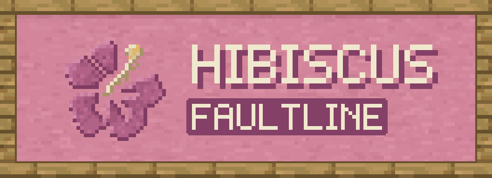

# Hibiscus Faultline



Mine a whole vein at once. Hold the Faultline key (`` ` `` by default) and break a block to take out
every matching block connected to it: ores, logs, stone, anything. It works with any tool or your bare
hand, and the config lets you set the limits.

Faultline also has a set of survival-friendly building tools: Move, Clone, Stack, Erase and Set, in an extra
slot beside the hotbar. Blocks come from and go to your inventory, nothing is free and nothing dupes, and every
change respects claims and protection. In creative they work like a proper creative building tool.

For Minecraft 26.3 on NeoForge 26.3.0.23-beta or newer. Needs [Hibiscus Lib](https://github.com/hibiscus-software/hibiscus-lib)
1.4.1 or newer.

## Using it

- **Hold the key** to see what would be mined: every block in the selection gets an outline, and a small
  panel in the corner, in the Hibiscus theme, shows the mode and the block count.
- **Break a block** while holding the key to mine the whole selection. Each block costs durability
  and hunger as usual, and Fortune, Silk Touch and other enchantments apply.
- **Scroll** while holding the key to change the mode:
  - **Shapeless**: every matching block connected to the one you broke
  - **Small Tunnel**: a 1x1 line into the face you hit
  - **Mining Tunnel**: 1 wide, 2 tall, into the face you hit
  - **Large Tunnel**: 3x3, into the face you hit
  - **Escape Tunnel**: a 1 wide, 2 tall staircase going up and away from you
  - **Small Square**: a flat 3x3 on the face you hit

Stone and deepslate versions of an ore count as the same block, and so do logs and wood from the same
tree. Leaves are only taken when you start on a leaf.

## Build tools

Scroll past either end of the hotbar to enter the tool slot, like a tenth slot (or bind "Toggle Build Tool
Slot"). While it's active your clicks drive the tool instead of the item in your hand. Scroll on to leave, or
once you have a selection (when the wheel belongs to the tool) Ctrl + scroll; a hotbar number also leaves. A selection belongs to its tool: switching tools, or finishing an operation, clears it.

### Controls

| Input | What it does |
| --- | --- |
| Left-click | First corner (sets it again at any time) |
| Right-click | Second corner (sets it again at any time). With Erase and nothing selected: erase up to 128 connected blocks of the same type |
| Middle-click | Moves the second corner to the block you're looking at (the option "Middle Click: Extend Select" chooses this or Move To for Move and Clone) |
| Scroll | Move and Clone: move the selection, up pushes it away from you and down pulls it closer. Stack: add copies along the axis you look along, a grid if you use more than one. Erase and Set: push or pull the face under the cursor |
| Hold X, Y or Z | While scrolling, keep to that axis |
| Shift + scroll | Stack: the gap between copies |
| Drag the sphere | Move and Clone: slide the destination |
| Ctrl+R / Ctrl+F | Move and Clone: turn the destination a quarter turn clockwise / flip it along the axis you face |
| While moving or stacking | Right-click confirms, left-click cancels (for Clone, finishes: the copy stays up after placing so you can place more), middle-click is Move To or stacks up to the clicked block |
| Delete / Backspace | Erase: confirm |
| Enter | Confirm (Set, or any tool ready to run) |
| Left-click during an operation | Pause; a second left-click stops |
| Escape | Steps back: stop, cancel the destination or copies, clear the selection, then the pause menu |
| Alt (hold) | Tool palette and options; Alt + scroll changes tool, up the column for scroll up |
| Shift + right-click | Link or unlink a container as a material source |
| Ctrl+Z / Ctrl+Y | Undo / redo |

An arrow on the selection shows which way scrolling up moves it. The preview shows ghost blocks where things will land, positions that will be skipped in red, and a bill of
materials: what the operation needs against what you have.

### The tools

- **Move** lifts the selection and puts it down at the destination. Chests keep their items and machines
  their state; nothing drops. Options: Keep Existing, Move Entities, Move Air.
- **Clone** copies block states, one matching item per block. Contents never come along: a chest arrives
  empty. Options: Keep Existing, Copy Air, Copy Entities (creative), Partial.
- **Stack** repeats the selection in a row, or a grid along more than one axis. Scroll adds copies along the axis
  you look along and Shift + scroll sets the gap. Each copy costs like Clone.
- **Erase** removes everything in the selection as if you mined it (confirm with Delete), or right-click a block with
  nothing selected to erase up to 128 connected blocks of its type. Options: Mask (only the block in your
  offhand, or the one you looked at when turning it on), Fluids.
- **Set** fills the selection with one block, picked from the options panel or held in your offhand. Options:
  Air Only, Replace, Hollow, Walls, Partial.

### Survival rules

- Materials come from your inventory and offhand, then linked containers. Only plain stacks are spent, never
  named, enchanted or filled items. Returns (drops, replaced blocks, undo refunds) go the same way, then drop at
  your feet (or stop the operation, with `overflow = "stop"`).
- Anything the tools break, Erase or a block in the way of Set, Clone, Stack or Move, takes its real mining time
  with the best tool you carry (times `eraseTimeMultiplier`), costs the same hunger as vein mining, and drops as
  if mined with that tool without its enchantments. Blocks you can't harvest are skipped. Move's own blocks are
  lifted, not broken: no time, no hunger, no drops.
- Every break and place asks protection mods first, as vanilla breaking and placing do.
- Bedrock and other unbreakable blocks, and anything in `hibiscusfaultline:build_immovable` (spawners, trial
  spawners, vaults and reinforced deepslate by default), are never touched.
- Undo refunds what an operation placed and puts back what it erased only if you can pay for it again. It only
  touches positions still as the operation left them.

In creative there are no materials, no drops, no hunger and no break time, Set lists every block, and the limits
are bigger. An operation keeps the rules it started under, so switching game mode can't be used for free refunds.

### Permissions and commands

Permission nodes (for a permissions mod; the defaults apply without one):

- `faultline.build.use`, and `faultline.build.move`, `.clone`, `.stack`, `.erase`, `.set`: default on
- `faultline.build.max_volume` (integer): a per-player volume limit; 0, the default, uses the config
- `faultline.build.bypass_protection`: skip protection checks; default for operators (level 2)

Operator commands: `/faultline build cancel <player>`, `/faultline build undo <player>` and
`/faultline build limits [player]`, which shows the limits that apply from the config and permissions.

## Configuration

Server settings (max blocks, max distance, hunger, cooldown, drop gathering, matching rules, enabled
modes) are synced to clients, so the preview always matches what the server will break. Client settings
cover the HUD, the outline colour and scrolling. Both can be edited from the Mods screen.

The build tools have their own `buildTools` section on each side. Server: `enabled`, `maxVolume` and
`maxVolumeCreative`, `maxDistance` and `maxDistanceCreative`, `blocksPerTick`, `eraseTimeMultiplier`,
`eraseParallel`, `eraseWithoutTool`, `maxStack`, `maxLinkedContainers`, `linkRange`, `overflow`,
`creativeCloneContents`, `ghostPreviewLimit`, `undoDepth`, `undoDepthCreative` and `undoMaxBlocks`. Client:
hints, ghost preview, the slot's position and the gizmo's sensitivity.

The server settings file is `hibiscusfaultline-synced.toml` on NeoForge 26.3.0.39-beta and newer, and
`hibiscusfaultline-server.toml` on earlier betas.

Tags for pack makers:

- `hibiscusfaultline:excluded` (blocks): never selected
- `hibiscusfaultline:included_only` (blocks): if it has any entries, only these blocks can be selected
- `hibiscusfaultline:excluded_tools` (items): holding one of these turns Faultline off
- `hibiscusfaultline:build_immovable` (blocks): the build tools never break, move or replace these

## Building

```
./gradlew build
```

The jar ends up in `build/libs`. Hibiscus Lib comes from GitHub Packages, which needs a token even for public
packages: put `gpr.user` (your GitHub user name) and `gpr.key` (a personal access token with `read:packages`) in
`~/.gradle/gradle.properties`. With a Hibiscus Lib checkout at `../hibiscus-lib` (or `-Phibiscuslib_dir=...`) the
build uses that instead and needs no token. Use `./gradlew runClient` or `./gradlew runServer` to test, and
`./gradlew runGameTestServer` to run the gametests.

## License

MIT, copyright Hibiscus Software. See [LICENSE](LICENSE).
